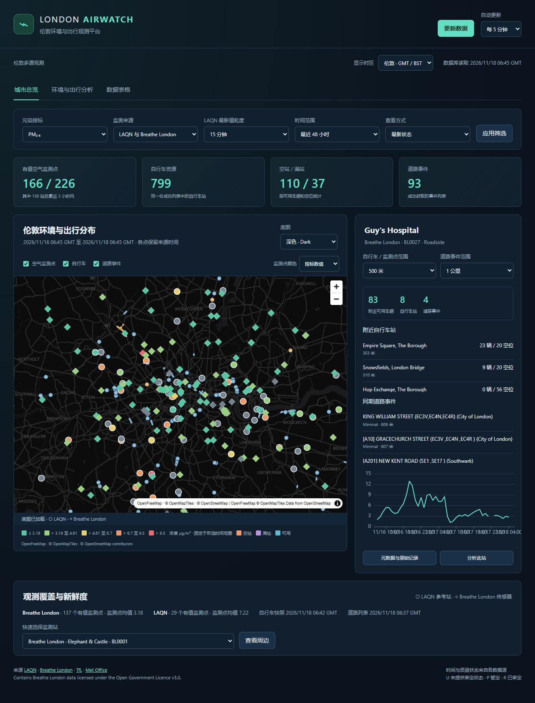

# London UrbanFlow

London UrbanFlow 是面向智慧城市课程的伦敦环境与出行观测平台。它把空气质量、共享单车、道路事件、气象观测和行政区划放到同一套地图与图表中，支持历史回放和出行路线规划。

## 快速启动

1. 在 Windows 上双击 [02_OPEN_DASHBOARD.bat](02_OPEN_DASHBOARD.bat)。项目需要 Python 3.10 或更高版本。
2. 保持启动窗口开启。浏览器默认打开 [本地仪表盘](http://127.0.0.1:8765/index.html)。如果 8765 端口已被占用，使用窗口中显示的地址。
3. 网页会读取本地数据库中已有的观测和快照。首次运行时可点「更新数据」，然后在「数据中心」查看采集结果。

也可以在项目根目录通过 PowerShell 启动：

```powershell
python .\tools\server.py --open
```

如果启动脚本找不到所需的 Python，请在 PowerShell 中将 `AIRWATCH_PYTHON` 设为你的 Python 解释器路径，再运行启动脚本：

```powershell
$env:AIRWATCH_PYTHON = 'C:\path\to\python.exe'
.\02_OPEN_DASHBOARD.bat
```



## 四个页面

| 页面 | 可以做什么 |
| --- | --- |
| 城市总览 | 查看污染浓度、监测点、共享单车、道路事件和行政区划。可切换底图和图层、查属性表、按小时回放、查看污染分区和选点周边。健康提示参考大伦敦官方 DAQI。 |
| 智慧出行 | 在地图上选起终点，规划步行、个人自行车或 Santander Cycles 共享单车路线。共享单车方案结合 TfL 车辆与空位快照选择取还车站。 |
| 环境与交通分析 | 先选择分析模块，再调整相关参数。污染趋势可对比最多 4 个站点；热力图、覆盖与缺测、气象关联的站点为单选。自行车时空分析在地图上回放最近 7 天的站点库存，并对比所选站 500 米内的邻站。行政区覆盖用地图填色和圆点展示有效时段占比与站点数，并配合排名列表联动查看。污染指标按来源提供：Breathe London 只有 PM₂.₅ 和 NO₂，LAQN 的四项指标只列出能观测该指标的站点。 |
| 数据中心 | 按来源查找站点和道路事件，查看元数据、历史观测、道路事件修订和采集状态。 |

## API 密钥

空气质量和 TfL 采集可直接运行。在线路线和新增 Met Office 气象观测使用各自的 API 密钥。

| Windows 用户变量 | 用途 | 获取方式 |
| --- | --- | --- |
| `ORS_API_KEY` | 步行和骑行道路路线 | 在 [HeiGIT 账户面板](https://account.heigit.org/) 复制 API Key。 |
| `MET_OFFICE_API_KEY` | Met Office 地面气象采集 | 在 [Weather DataHub](https://datahub.metoffice.gov.uk/docs/getting-started) 订阅 Land Observations，再从 My Subscriptions 复制 API Key。 |

在 Windows 中打开「环境变量」，在「用户变量」区域创建这两个变量。保存后关闭原启动窗口，重新启动网页服务。气象采集另支持 `%APPDATA%\LondonAirWatch\credentials.txt`，格式见[多源数据采集说明](docs/Live_Collection_CN.md)。

## 更新、诊断与测试

网页默认每 5 分钟检查一次已到期的采集任务，在标签页隐藏时暂停检查。各来源按自己的频率更新。也可以在 PowerShell 中查询状态或手动运行采集：

```powershell
python .\tools\collect_live.py status
python .\tools\collect_live.py run-once
```

- 双击 [08_DIAGNOSE_AIR_DATA.bat](08_DIAGNOSE_AIR_DATA.bat)，可读取数据库记录数、采集错误，并用 Windows curl 检查两个 LAQN 接口。此诊断对数据库只读。
- 双击 [04_RUN_TESTS.bat](04_RUN_TESTS.bat)，或运行 `python .\tools\run_tests.py`，可执行项目测试。安装 Node.js 后，测试入口会继续运行 JavaScript 测试。
- 城市总览、分析和数据中心的站点观测使用最近 48 小时的数据。地图标题旁可切换污染指标和历史回放。Windows 定时采集和 Westminster 离线归档见[多源数据采集说明](docs/Live_Collection_CN.md)。

## 项目结构

网页由原生 HTML、CSS 和 JavaScript 构成。Python 本地服务从 SQLite 读取观测和快照，地图与图表使用本地自带的 MapLibre GL JS、Supercluster 和 ECharts。在线底图、最新数据采集和路线服务需要网络连接。

```text
index.html          网页入口
assets/             前端脚本、样式和第三方库
tools/              本地服务、采集、诊断和测试入口
tests/              Python 和 JavaScript 测试
data/               伦敦行政边界及本地运行数据
docs/               采集文档、指标说明和界面示例
backups/            可恢复的历史文件
```

本地数据库位于 `data/live/airwatch_live.sqlite3`，原始响应和年度 ZIP 也保存在 `data/live/`。该目录已由 `.gitignore` 排除。各数据源、图表计算口径及历史快照见[数据与可视化说明](docs/Current_Data_Visualization_CN.md)。前端库许可证在 [assets/vendor](assets/vendor/)。
