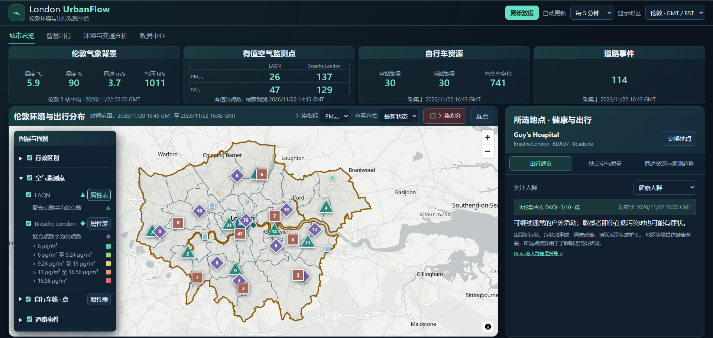

# London UrbanFlow

London UrbanFlow 是面向智慧城市课程的伦敦环境与出行观测平台。它把空气质量、共享单车、道路事件、气象观测和行政区划放到同一套地图与图表中，支持历史回放和出行路线规划。

## 快速启动

项目需要 Python 3.10 或更高版本。网页由 Flask 提供本地服务，依赖见 [requirements.txt](requirements.txt)。

### Windows

```powershell
py -3 -m venv .venv
.\.venv\Scripts\python -m pip install -r requirements.txt
.\.venv\Scripts\python run.py --open
```

如果系统没有 `py` 启动器，把 `py -3` 换成 `python`。服务默认监听 `http://127.0.0.1:8765/`；端口被占用时用 `--port 8766` 换一个端口。

### Linux / macOS

```bash
bash scripts/setup.sh
bash scripts/serve.sh --host 0.0.0.0 --port 8765
```

`scripts/setup.sh` 会创建 `.venv` 并安装依赖。`scripts/serve.sh` 会自动使用 `.venv` 中的 Python。

### 部署到 Linux 服务器（tmux）

```bash
bash scripts/setup.sh
bash scripts/tmux.sh start
```

`tmux.sh start` 默认以 `0.0.0.0:8765` 在名为 `urbanflow` 的 tmux 会话中后台运行，并打印服务器访问地址。断开 SSH 后服务仍在运行。

```bash
bash scripts/tmux.sh logs      # 查看日志
bash scripts/tmux.sh attach    # 进入 tmux 会话
bash scripts/tmux.sh stop      # 停止服务
bash scripts/tmux.sh status    # 查看状态
```

服务器部署、防火墙、反向代理和定时采集的完整说明见 [Linux/Windows 部署说明](docs/Deploy_CN.md)。

> 安全提示：服务没有内置身份验证。默认只监听 `127.0.0.1`；使用 `0.0.0.0` 时请用防火墙限制来源，或通过 SSH 隧道、带认证的反向代理访问，不要直接暴露到公网。



## 四个页面

| 页面 | 可以做什么 |
| --- | --- |
| 城市总览 | 查看污染浓度、监测点、共享单车、道路事件和行政区划。可选择图层、查属性表、按前 48 小时回放、查看污染分区和选点周边。健康提示参考大伦敦官方 [DAQI](https://www.gov.uk/government/publications/health-effects-of-air-pollution/using-the-daily-air-quality-index-daqi)。 |
| 智慧出行 | 在地图上选起点和终点，规划步行、个人自行车或 Santander Cycles 共享单车路线。共享单车方案结合 [TfL](https://tfl.gov.uk/)  车辆与空位快照选择取还车站；步行明显更快或取还车站相同时自动改用步行路线。 |
| 环境与交通分析 | 先选择分析模块，再调整相关参数。污染趋势可对比最多 4 个站点；热力图、覆盖与缺测、气象关联的站点为单选。自行车时空分析在地图上回放最近 7 天的站点库存，并对比所选站 500 米内的邻站。行政区覆盖用地图填色和圆点展示有效时段占比与站点数，并配合排名列表联动查看。污染指标按来源提供：[Breathe London](https://www.breathelondon.org/) 只有 PM₂.₅ 和 NO₂，[LAQN](https://www.londonair.org.uk/) 的四项指标只列出能观测该指标的站点。 |
| 数据中心 | 按来源查找站点和道路事件，查看元数据、历史观测、道路事件修订和采集状态。 |

## API 密钥

空气质量和 TfL 采集可直接运行。在线路线和新增 Met Office 气象观测使用各自的 API 密钥。

| 环境变量 | 用途 | 获取方式 |
| --- | --- | --- |
| `ORS_API_KEY` | 步行和骑行道路路线 | 在 [HeiGIT 账户面板](https://account.heigit.org/) 复制 API Key。 |
| `MET_OFFICE_API_KEY` | Met Office 地面气象采集 | 在 [Weather DataHub](https://datahub.metoffice.gov.uk/docs/getting-started) 订阅 Land Observations，再从 My Subscriptions 复制 API Key。 |

Linux 可以在当前 shell 中直接设置，也可以写入 `~/.bashrc` 或服务环境：

```bash
export ORS_API_KEY='你的密钥'
export MET_OFFICE_API_KEY='你的密钥'
```

Windows 可以设置当前用户环境变量，重新打开终端后生效：

```powershell
[Environment]::SetEnvironmentVariable('ORS_API_KEY','你的密钥','User')
[Environment]::SetEnvironmentVariable('MET_OFFICE_API_KEY','你的密钥','User')
```

气象采集还支持项目目录外的凭据文件：

- Windows：`%APPDATA%\LondonAirWatch\credentials.txt`
- Linux：`~/.config/LondonAirWatch/credentials.txt`

格式见[多源数据采集说明](docs/Live_Collection_CN.md)。不要把密钥写进网页、数据库、命令行参数或日志。

## 更新、诊断与测试

网页默认每 5 分钟检查一次已到期的采集任务，在标签页隐藏时暂停检查。各来源按自己的频率更新。也可以在终端中查询状态或手动运行采集：

```bash
python tools/collect_live.py status
python tools/collect_live.py run-once
```

Linux 服务器建议用 cron 定时采集：

```cron
*/5 * * * * cd /path/to/London_UrbanFlow && bash scripts/collector.sh >> data/live/collector.log 2>&1
```

Windows 可以继续使用任务计划程序：

```powershell
powershell -ExecutionPolicy Bypass -File tools\install_live_task.ps1 -Python .\.venv\Scripts\python.exe
```

- 运行 `python tools/diagnose_data.py` 可读取数据库记录数、采集错误，并用系统 `curl` 检查 LAQN 接口。此诊断对数据库只读。
- 运行 `python tools/run_tests.py` 可执行项目测试。安装 Node.js 后，测试入口会继续运行 JavaScript 测试。
- 运行 `python tools/prune_db.py --dry-run` 可查看各表按保留期将删除的行数；加 `--vacuum` 回收磁盘。静态资源默认按内容哈希长缓存，`URBANFLOW_COMPRESS=0` 可关闭应用内 gzip。
- 城市总览、分析和数据中心的站点观测使用最近 48 小时的数据。地图标题旁可切换污染指标和历史回放。

## 项目结构

网页由原生 HTML、CSS 和 JavaScript 构成。Python Flask 服务从 SQLite 读取观测和快照，地图与图表使用本地自带的 MapLibre GL JS、Supercluster 和 ECharts。在线底图、最新数据采集和路线服务需要网络连接。

```text
run.py              跨平台启动入口（Windows/Linux 通用）
requirements.txt    Flask 与 waitress
index.html          网页入口
assets/             前端脚本、样式和第三方库
tools/              Flask 服务、采集、诊断和测试入口
scripts/            Linux 安装、启动、tmux 和定时采集脚本
tests/              Python 和 JavaScript 测试
data/               伦敦行政边界及本地运行数据
docs/               部署、采集、指标说明和界面示例
```

本地数据库位于 `data/live/airwatch_live.sqlite3`，原始响应和年度 ZIP 也保存在 `data/live/`。该目录已由 `.gitignore` 排除，不会进入远程仓库。数据库路径可用 `URBANFLOW_DB` 覆盖；部署在网络盘上时，建议把整个 `data/live` 目录迁到本地磁盘并在原位置保留目录软链接（步骤见[部署说明](docs/Deploy_CN.md)）。`python tools/backup_db.py` 可在服务运行中生成一致性快照并保留最近几份。`data.js`、`data/hourly_v2.csv`、`seed/` 等是本地历史 2025 数据，当前实时页面不加载它们；缺少这些文件不影响服务启动。

各数据源、图表计算口径及历史快照见[数据与可视化说明](docs/Current_Data_Visualization_CN.md)。前端库许可证在 [assets/vendor](assets/vendor/)。
