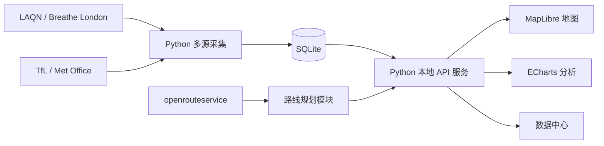

# London UrbanFlow

### 伦敦环境与出行观测平台

**London UrbanFlow** 是面向智慧城市课程设计的多源城市数据可视化系统。项目以英国伦敦为研究区域，整合空气质量、共享单车、道路事件、气象观测和行政区划数据，将分散的数据汇集到同一张交互地图，并提供历史回放、统计分析与出行路线规划。

系统采用 **Python 标准库 + SQLite + 原生 JavaScript** 实现，前端集成 **MapLibre GL JS、ECharts 和 Supercluster**。本地启动即可使用，无需部署数据库服务器，也不要求安装 Node.js 才能打开网页。

> 课程主题：基于多源开放数据的伦敦城市环境监测与智慧出行可视化。

## 目录

- [项目展示](#项目展示)
- [主要功能](#主要功能)
- [数据来源](#数据来源)
- [快速启动](#快速启动)
- [API 密钥配置](#api-密钥配置)
- [数据采集与更新](#数据采集与更新)
- [技术架构与目录结构](#技术架构与目录结构)
- [数据库与数据快照](#数据库与数据快照)
- [运行测试](#运行测试)
- [常见问题](#常见问题)
- [参考资料与致谢](#参考资料与致谢)

## 项目展示


*项目随附的界面示例图；具体布局以当前版本运行页面为准。*

系统提供四个主要页面：**城市总览、智慧出行、环境与交通分析、数据中心**。地图支持深色与浅色底图、真实地理坐标定位、图层开关，以及监测站与道路事件详情查询。

## 主要功能

### 1. 城市总览

- 在地图上展示 LAQN 和 Breathe London 空气质量监测点，以及共享单车停靠站、道路事件和伦敦行政区边界。
- 查询 **PM₂.₅、PM₁₀、NO₂、O₃** 浓度及部分污染物空气质量指数。
- 支持按监测来源、15 分钟/小时数据、最近 48 小时/7 天/自定义日期筛选。
- 提供**最新状态**和**历史回放**两种查看方式；可使用时间轴逐小时浏览。
- 提供监测点聚合、图层属性表、站点搜索、周边资源查询和污染趋势小图。
- 可开启**污染划分**图层，按行政区内监测数据分档着色，直观查看污染空间差异。
- 选择地点和关注人群后，结合官方大伦敦 DAQI 信息展示**健康与出行提示**，支持健康人群、老年人、儿童与照护者、哮喘人群、其他心肺疾病人群。

### 2. 智慧出行

- 在地图上指定出发地和目的地。
- 提供**步行、个人自行车、Santander Cycles 共享单车**三种出行模式。
- 共享单车模式结合已采集的 TfL 车辆与空位快照寻找取车、还车站。
- 配置 `ORS_API_KEY` 后，通过 openrouteservice 计算实际道路路线、距离和预计用时。
- 结合附近空气质量读数与道路事件，为出行选择提供参考。

### 3. 环境与交通分析

- **污染趋势**：对比最多 4 个监测站的污染物时间序列。
- **小时热力图**：查看不同日期与小时的污染浓度变化。
- **覆盖与缺测**：展示有效站点数量以及缺测时段分布。
- **气象关联**：将污染浓度与风速、温度、湿度同步展示，并对可配对的小时数据进行相关性分析。
- **自行车时序**：查看站点车辆数与空位数随时间的变化。
- **行政区覆盖**：统计各区空气监测站分布与数据覆盖情况。

### 4. 数据中心

- 分来源浏览 LAQN、Breathe London、TfL、Met Office 及伦敦行政区数据。
- 查看站点位置、观测指标、时间、单位、历史记录与道路事件详情。
- 支持关键词搜索、分页、条件筛选和采集任务状态查看。
- 可在网页顶部手动点击**更新数据**，也可设置自动检查间隔。

## 数据来源

| 来源 | 主要数据 | 项目内用途 | 密钥要求 |
| --- | --- | --- | --- |
| [LAQN](https://api.erg.ic.ac.uk/AirQuality/help) | PM₂.₅、PM₁₀、NO₂、O₃、部分小时指数 | 空气质量监测、趋势和空间展示 | 不需要 |
| [Breathe London](https://www.breathelondon.org/) | 城市传感器 PM₂.₅、NO₂及部分指数 | 城市监测点补充、站点对比 | 当前采集方式不需要 |
| [TfL Unified API](https://api.tfl.gov.uk/) | Santander Cycles 停靠站状态、道路扰动事件 | 共享单车、道路事件、出行分析 | 当前采用匿名接口 |
| [Met Office](https://datahub.metoffice.gov.uk/) | 温度、湿度、风速、风向、气压等 | 气象监测与污染关联分析 | `MET_OFFICE_API_KEY` |
| [openrouteservice](https://openrouteservice.org/) | 步行、骑行路线 | 智慧出行路线规划 | `ORS_API_KEY` |
| [Defra UK-AIR](https://uk-air.defra.gov.uk/) | 大伦敦官方 DAQI 信息 | 健康与出行参考 | 不需要 |
| [ONS / OS](https://www.ons.gov.uk/methodology/geography/licences) | 大伦敦及 33 个行政区边界 | 地图行政区划 | 不需要 |
| [OpenFreeMap](https://openfreemap.org/) / [OpenStreetMap](https://www.openstreetmap.org/) | 道路与地理底图 | 地图交互展示 | 不需要，需联网加载底图 |

不同来源的更新节奏不同。网页的“每 5 分钟”表示检查并执行**已到期**的采集任务，并不表示所有监测数据每 5 分钟都会更新一次。

## 快速启动

### 环境要求

- Windows 10/11（项目附带 Windows 启动脚本），或可运行 Python 的其他桌面系统。
- **Python 3.10 及以上**。
- 常规网页与采集程序仅使用 Python 标准库；地图与在线接口需要网络连接。
- **Node.js 为可选工具**，仅用于运行 JavaScript 测试，不是启动系统的必要条件。

### 方法一：Windows 一键启动（推荐）

1. 解压项目，进入**包含 `index.html`、`tools` 和 `02_OPEN_DASHBOARD.bat` 的最内层项目根目录**。
2. 双击 **`02_OPEN_DASHBOARD.bat`**。
3. 浏览器会打开本地网页。默认地址为：

   `http://127.0.0.1:8765/index.html`

4. 保留启动程序的命令窗口；关闭窗口即停止本地服务。如果 8765 端口已被占用，以窗口显示的实际地址为准。

> 该压缩包采用了两层同名文件夹结构，请以能看到 `index.html` 的那一层作为项目根目录。

### 方法二：命令行启动

在项目根目录执行：

```powershell
python .\tools\server.py --open
```

如果系统无法自动定位 Python，可显式指定解释器（以下为一个 Anaconda 示例路径）：

```powershell
$env:AIRWATCH_PYTHON = 'D:\anaconda3\envs\gpu\python.exe'
& $env:AIRWATCH_PYTHON .\tools\server.py --open
```

也可以在设置好 `AIRWATCH_PYTHON` 后双击 `02_OPEN_DASHBOARD.bat`。

### 首次使用

- 如果随包附带 `data/live/airwatch_live.sqlite3`，打开网页即可浏览数据库中**已保存的**历史数据和快照。
- 如果新克隆项目或数据库为空，先运行下一节的采集命令，再刷新网页。
- 在城市总览中选择污染物与监测来源，点击地图上的监测站查看详情；需要路线规划时进入“智慧出行”页面。

## API 密钥配置

本项目主要使用两个可选密钥。**没有密钥也可以浏览已保存的空气质量、共享单车和道路数据。**

| 变量名 | 对应功能 | 代码读取位置 |
| --- | --- | --- |
| `ORS_API_KEY` | 步行和骑行路线规划 | `tools/journey.py`，从启动服务器的环境变量读取 |
| `MET_OFFICE_API_KEY` | Met Office 观测数据采集 | `tools/collect_live.py`，环境变量或用户配置文件 |

**Windows 图形界面配置方法：** 搜索“编辑系统环境变量” → “环境变量” → “用户变量” → “新建”，分别创建以上两个变量，变量值粘贴对应平台提供的密钥。保存后重新打开终端与网页服务器。

在 PowerShell 中可以不显示密钥地检查是否加载：

```powershell
[bool]$env:ORS_API_KEY
[bool]$env:MET_OFFICE_API_KEY
```

Met Office 还支持在当前 Windows 用户目录创建配置文件：

`%APPDATA%\LondonAirWatch\credentials.txt`

```ini
MET_OFFICE_API_KEY=替换为你自己的密钥
```

`ORS_API_KEY` **应配置为环境变量**，不要写入上述配置文件；当前采集器只识别该文件中指定的气象密钥等字段。API 密钥不要放到网页代码或公开仓库。

## 数据采集与更新

### 手动采集

在项目根目录打开 PowerShell 或 CMD：

```powershell
# 执行已到期的采集任务
python .\tools\collect_live.py run-once

# 查看 LAQN、Breathe London、TfL、Met Office 等任务的状态
python .\tools\collect_live.py status

# 立即尝试全部已配置来源（便于首次采集或排查）
python .\tools\collect_live.py run-once --force
```

若使用指定的 Anaconda Python，把上述 `python` 替换为完整 `python.exe` 路径即可。

默认采集安排：

| 采集任务 | 主要内容 | 检查频率 |
| --- | --- | --- |
| `laqn_sites` | LAQN 站点目录 | 每天 |
| `laqn_hourly`、`laqn_15min` | LAQN 小时值、15 分钟值 | 每小时 |
| `breathe_web_hourly` | Breathe London 站点近期数据 | 每小时 |
| `breathe_web_reconcile` | Breathe London 站点曲线补查 | 每 5 分钟检查补查任务 |
| `tfl_bikes`、`tfl_roads` | 自行车停靠站、道路事件 | 每 5 分钟 |
| `met_sites`、`met_hourly` | 气象站与观测值 | 每天 |

网页内的“更新数据”按钮也会触发采集流程，并显示任务进度。项目已包含 `tools/secure_curl.py`，用于提高 Windows 下 HTTPS 数据采集的兼容性。

### 可选：Windows 定时采集

```powershell
powershell -ExecutionPolicy Bypass -File .\tools\install_live_task.ps1 -Python 'D:\anaconda3\envs\gpu\python.exe'
```

它会创建 `LondonAirWatchLiveCollector` 计划任务，按 5 分钟间隔检查到期任务。

### 数据存储

```text
data/live/
├── airwatch_live.sqlite3        # 本地 SQLite 数据库
└── raw/                         # 按来源和日期保存的原始响应缓存
```

主要数据表包括：

- `locations`：监测站、气象站、自行车站点的元数据与坐标。
- `measurements`：空气污染物、气象要素及相关测量记录。
- `bike_snapshots`：共享单车站的车辆和空位历史快照。
- `road_events`：道路事件及其当前状态。
- `job_state`、`fetch_runs`：采集任务状态和请求日志。

原始响应归档和SQLite数据库均位于本地；`.gitignore` 已排除 `data/live/`，常规Git提交不会包含采集数据库。

## 技术架构与目录结构



| 技术 | 用途 |
| --- | --- |
| Python 3.10+ | HTTP采集、数据解析、本地API和路线规划 |
| SQLite | 站点、监测记录、车辆快照、道路事件、采集状态存储 |
| HTML / CSS / JavaScript | 页面布局与交互 |
| MapLibre GL JS 5.6.2 | 地理底图及空间数据展示 |
| ECharts 5.6.0 | 趋势曲线、热力图及关联分析 |
| Supercluster 8.0.1 | 自行车站和地图点位聚合 |
| GeoJSON | 大伦敦及行政区边界 |

核心目录结构：

```text
London_UrbanFlow-main/
├── index.html                    # 系统网页入口
├── README.md                     # 项目说明（本文件）
├── 02_OPEN_DASHBOARD.bat         # Windows 网页启动脚本
├── 04_RUN_TESTS.bat              # 测试脚本
├── 08_DIAGNOSE_AIR_DATA.bat      # 数据诊断脚本
├── assets/
│   ├── city.js / city.css        # 地图、总览与环境分析
│   ├── journey.js                # 智慧出行交互
│   ├── insights.js               # 污染划分与出行提示
│   ├── live.js / live.css        # 数据中心等基础页面
│   └── vendor/                   # MapLibre、ECharts、Supercluster
├── tools/
│   ├── server.py                 # 本地网页及 API 服务
│   ├── collect_live.py           # 多源数据采集
│   ├── secure_curl.py            # HTTPS / curl 网络兼容
│   ├── journey.py                # ORS 路线规划与健康信息
│   ├── city_analysis.py          # 空间和时序分析
│   ├── live_api.py               # 数据查询接口
│   ├── live_store.py             # SQLite 存储
│   ├── collect_met_all.py        # Met Office 扩展采集
│   └── diagnose_data.py          # 数据采集诊断
├── data/
│   ├── london_region_2025.geojson
│   ├── london_boroughs_2025.geojson
│   └── live/
│       └── airwatch_live.sqlite3
├── docs/                         # 项目截图及中文技术说明
└── tests/                        # Python / JavaScript 测试
```

## 数据库与数据快照

此次随附压缩包内的 SQLite 数据库已包含真实采集记录。以下为 **2026-11-20 上传版本的本地数据库快照**，不是持续更新的固定指标：

| 统计项目 | 快照记录数 |
| --- | ---: |
| 位置记录 `locations` | 1,217 |
| 测量记录 `measurements` | 117,323 |
| 自行车历史快照 `bike_snapshots` | 23,200 |
| 道路事件 `road_events` | 109 |

实际网页展示结果由时间筛选、污染指标、监测来源和最新采集情况决定。要查看更新后的数量，运行 `collect_live.py status`，或打开“数据中心”。

## 运行测试

直接双击 `04_RUN_TESTS.bat`，或在项目根目录运行：

```powershell
python .\tools\run_tests.py
```

- **Python单元测试**：运行项目 `tests/test_*.py`。
- **JavaScript测试**：若电脑安装了 Node.js，测试脚本会继续运行已有前端测试；未安装时会提示跳过，不影响网页使用。
- **采集诊断**：双击 `08_DIAGNOSE_AIR_DATA.bat`，查看数据库记录数、任务错误和LAQN接口连通情况。

## 常见问题

**1. 双击启动脚本提示 `Python 3.10+ not found`**

先确认 `python --version`，或在 PowerShell 中设置正确路径：

```powershell
$env:AIRWATCH_PYTHON = 'D:\anaconda3\envs\gpu\python.exe'
.\02_OPEN_DASHBOARD.bat
```

如果仍无法启动，直接使用该解释器运行 `tools/server.py --open`。

**2. 地图能打开，但监测站或统计显示 `0/0`**

先执行 `python tools/collect_live.py status` 检查数据库与采集任务；如果数据已经存在，尝试将监测来源切换为 LAQN、粒度切换为 1 小时，并扩大时间范围。

**3. 采集程序报 `SSLError`**

项目包含 `tools/secure_curl.py` 处理部分 Windows Python HTTPS 兼容问题。可运行 `08_DIAGNOSE_AIR_DATA.bat` 检查接口连接，再通过 `collect_live.py status` 确定具体失败来源。

**4. 气象数据为空**

检查 `MET_OFFICE_API_KEY` 是否配置，以及 `met_sites` / `met_hourly` 的任务状态。

**5. 自行车或道路事件为空**

检查 `tfl_bikes`、`tfl_roads` 是否采集成功；共享单车显示还受时间范围、站点快照时效和图层开关影响。

**6. 步行或骑行无法规划路线**

确认启动网页服务器的终端已读取 `ORS_API_KEY`，然后重新选择起点和终点。道路路线需要联网调用 openrouteservice。

**7. 提示 `Install Node.js to run the JavaScript tests`**

这只是表示跳过了可选的 JavaScript 单元测试；不影响网页启动。

## 参考资料与致谢

项目使用英国公开城市观测数据和开源前端组件。数据来源、具体采集规则和许可归属以各来源官方说明为准：

- [LAQN — London Air Quality Network](https://www.londonair.org.uk/)
- [Breathe London](https://www.breathelondon.org/)
- [Transport for London](https://tfl.gov.uk/)
- [Met Office](https://www.metoffice.gov.uk/)
- [UK-AIR / Defra](https://uk-air.defra.gov.uk/)
- [OpenStreetMap](https://www.openstreetmap.org/)、[OpenFreeMap](https://openfreemap.org/)、[openrouteservice](https://openrouteservice.org/)

第三方前端库的许可证文本位于 `assets/vendor/`。更多技术细节可阅读：

- [`docs/Live_Collection_CN.md`](docs/Live_Collection_CN.md)：多源数据采集与更新机制。
- [`docs/Current_Data_Visualization_CN.md`](docs/Current_Data_Visualization_CN.md)：地图、图表、数据指标和时间处理说明。

---

**London UrbanFlow · 智慧城市课程设计**  
以真实城市数据为基础，观察伦敦空气质量与城市出行的时空变化。
